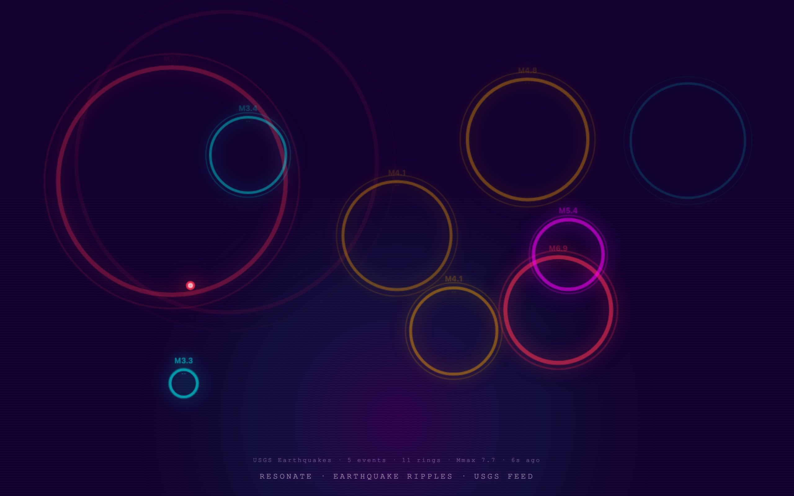

<div align="center">

<h1>resonate</h1>

<p><b>Earthquakes as neon ripples.</b></p>

<p><i>Every quake USGS logged in the last hour lands as an expanding ring, coloured by magnitude.</i></p>

<h6>


</h6>

<a href="https://parthchandak02.github.io/resonate/"><b>Live demo</b></a> ·
<a href="#how-it-works"><b>How it works</b></a> ·
<a href="#run-it"><b>Run it</b></a>

<br><br>

<a href="https://parthchandak02.github.io/resonate/"></a>

<sub>Live capture, 22 October 2026, after three clicks. Mixes real USGS events, decorative rings and clicked rings (see below).</sub>

</div>

<br>

A synthwave canvas of rings. It reads the [USGS real-time feed](https://earthquake.usgs.gov/earthquakes/feed/v1.0/geojson.php)
of every earthquake in the past hour, places each one by longitude and latitude on a flat
world projection, and lets it ripple out and fade over four seconds. Bigger quakes make
wider, thicker, brighter rings. It is a single HTML file with no libraries and no API key.

## How it works

| Quake field | Drives |
|---|---|
| `mag` | Ring size (30 to 330 px), stroke width, starting opacity, and the `M4.1` label |
| `mag` band | Colour: green below 2, cyan below 4, amber below 5, magenta below 6, red at 6 and above |
| Longitude, latitude | Position on an equirectangular map of the window |
| Depth, place | A small label under the magnitude, such as `CA · 8km` |

The feed is fetched again every 15 seconds and the first 25 events are re-spawned each time.
A data bar shows the feed's event count, live rings, the largest magnitude on screen and
the time since the last fetch.

Not every ring is a real quake. To keep the canvas busy, a decorative ring with a random
magnitude spawns at a random spot about twice a second, and five more open the page. If the
feed fails, twelve random rings stand in. Click or tap anywhere to drop your own ring.

## Run it

```bash
git clone https://github.com/parthchandak02/resonate.git
cd resonate
python3 -m http.server 8000   # then open http://localhost:8000
```

<details>
<summary><b>Project layout</b></summary>

```
index.html          Everything: config object C, ripple class, USGS fetch, drawing, click handler
sample_quakes.json  A saved USGS query response (five large quakes); not loaded by the page
.nojekyll           Serves the folder as-is on GitHub Pages
```

</details>

<details>
<summary><b>Other pieces in the series</b></summary>

[tessellate](https://parthchandak02.github.io/tessellate/) ·
[flora](https://parthchandak02.github.io/flora/) ·
[grow](https://parthchandak02.github.io/grow/) ·
[drift](https://parthchandak02.github.io/drift/) ·
[trace](https://parthchandak02.github.io/trace/) ·
[swell](https://parthchandak02.github.io/swell/) ·
[flux](https://parthchandak02.github.io/flux/)

</details>

<br>

<div align="center">
<sub>Built with the Canvas 2D API and plain JavaScript. Data from the USGS Earthquake Hazards Program.</sub>
</div>
